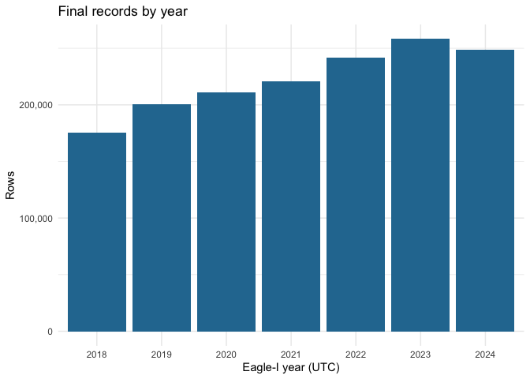
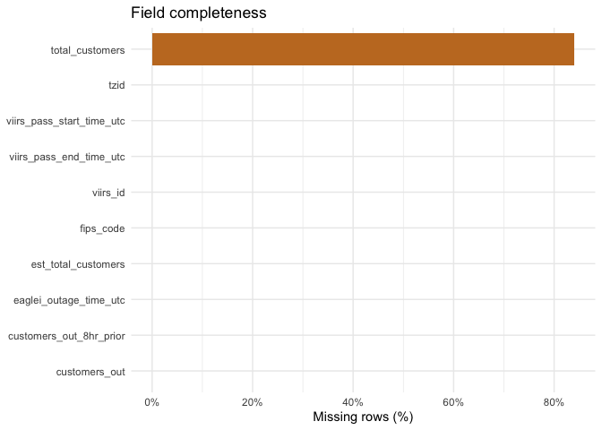

# QC: Outages with VIIRS Image

## Scope

This report checks the final Parquet file’s schema, completeness, county
codes, duplicate keys, outage-to-granule time overlap, local-time
selection, and selected numeric values. Checks are descriptive; review
flags do not modify the dataset.

The report reads the existing Parquet file; it does not rebuild it. Run
`make` before rendering after changing preprocessing logic.

The local-time check uses the generated county time-zone lookup tables
when available. The current Parquet schema does not retain `tzid`, so
the report reconstructs it from those lookup files.

## Dataset overview

| Measure                       | Value                            |
|:------------------------------|:---------------------------------|
| File                          | outages-with-viirs-image.parquet |
| File size                     | 13.6 MiB                         |
| Rows                          | 1,557,024                        |
| Columns                       | 10                               |
| County FIPS codes             | 3,077                            |
| FIPS state/territory prefixes | 52                               |
| VIIRS granule IDs             | 18,061                           |
| Earliest Eagle-I time (UTC)   | 2018-01-01 08:45:00 UTC          |
| Latest Eagle-I time (UTC)     | 2024-12-31 12:00:00 UTC          |

### Rows by year

## Completeness and schema

| Field                     | Type      | Missing rows | Missing (%) |
|:--------------------------|:----------|-------------:|------------:|
| fips_code                 | string    |            0 |        0.00 |
| eaglei_outage_time_utc    | timestamp |            0 |        0.00 |
| viirs_id                  | string    |            0 |        0.00 |
| viirs_pass_start_time_utc | timestamp |            0 |        0.00 |
| viirs_pass_end_time_utc   | timestamp |            0 |        0.00 |
| tzid                      | string    |            5 |        0.00 |
| total_customers           | numeric   |      1308281 |       84.02 |
| est_total_customers       | numeric   |            0 |        0.00 |
| customers_out             | numeric   |            0 |        0.00 |
| customers_out_8hr_prior   | numeric   |            0 |        0.00 |

`total_customers` contains only values provided by the raw Eagle-I
files; it is not filled from coverage estimates. `est_total_customers`
is a separate estimate allocated from state coverage totals using ACS
county household shares, with 2022 totals carried forward to estimate
2023–2024. Connecticut uses 2021 ACS county estimates from the last
vintage with its former county geography. U.S. Virgin Islands records
(FIPS prefix `78`) are excluded. Missing `total_customers` values are
expected when the raw file does not provide them.

## Integrity checks

| Check | Status | Result |
|:---|:---|:---|
| Expected fields present | PASS | 9 expected fields present |
| County FIPS has five digits | PASS | 0 invalid codes |
| U.S. Virgin Islands excluded | PASS | 0 Virgin Islands rows |
| CT legacy-county estimates present | PASS | 0 post-2021 CT legacy-county estimates missing |
| Composite row key is unique | PASS | 0 duplicate rows |
| VIIRS pass end follows pass start | PASS | 0 invalid durations |
| 15-minute outage interval overlaps VIIRS pass | PASS | 0 non-overlapping intervals |
| County time zone and local-hour filter | REVIEW | 5 missing time zones; 0 rows outside local hours 00:00–02:45 |
| Nonnegative customer counts | PASS | 0 negative values |
| customers_out does not exceed county estimate | REVIEW | 724 rows exceed the ACS-based county estimate |

`customers_out` exceeding `est_total_customers` is flagged for review,
not treated as an automatic failure: the county customer estimate is
allocated from state totals using ACS household shares.

## Numeric summaries

| Field | Nonmissing values | Minimum | Median | 95th percentile | Maximum |
|:---|---:|---:|---:|---:|---:|
| total_customers | 248743 | 5 | 50781.00 | 660977.00 | 3799750.00 |
| est_total_customers | 1557024 | 23 | 46881.00 | 689242.00 | 3983422.00 |
| customers_out | 1557024 | 0 | 5.00 | 669.00 | 474732.00 |
| customers_out_8hr_prior | 1557024 | 0 | 0.16 | 20.91 | 14835.38 |
